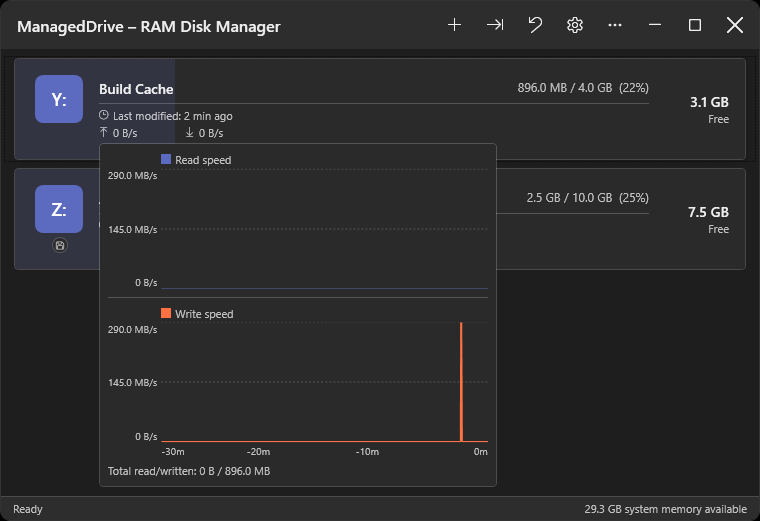
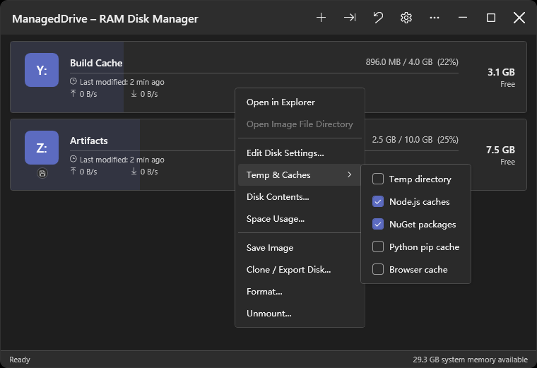
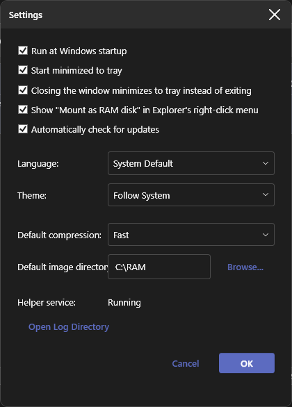
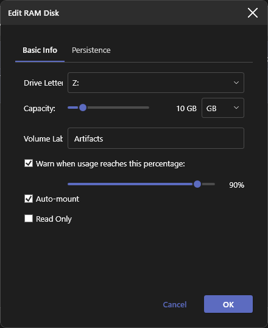
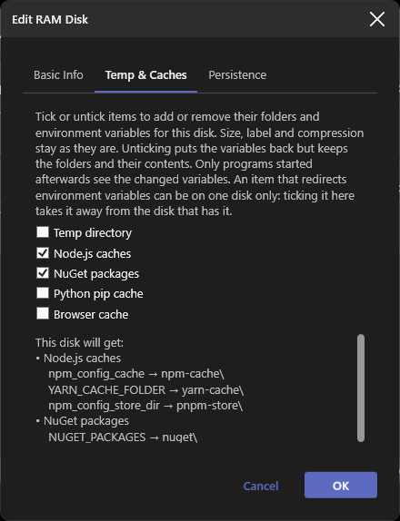
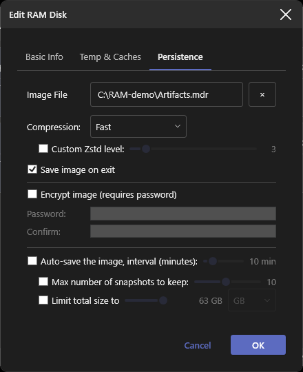

# ManagedDrive

[](https://github.com/coldhighsun/ManagedDrive/actions/workflows/ci.yml)
[](https://codecov.io/gh/coldhighsun/ManagedDrive)
[](https://github.com/coldhighsun/ManagedDrive/releases/latest)
[](https://github.com/coldhighsun/ManagedDrive/releases)
[](https://github.com/coldhighsun/ManagedDrive/releases)
[](https://github.com/coldhighsun/ManagedDrive/issues)
[](https://github.com/coldhighsun/ManagedDrive/pulls)
[](https://github.com/coldhighsun/ManagedDrive/commits/main)
[](https://github.com/coldhighsun/ManagedDrive/stargazers)
[](LICENSE)
[](https://dotnet.microsoft.com/)
[](https://github.com/coldhighsun/ManagedDrive)

English | [中文](README.zh-CN.md)

---

A Windows RAM disk manager built on .NET 10 and [WinFsp](https://winfsp.dev).  
Create, mount and manage in-memory volumes that appear as normal drive letters in Explorer.

### Screenshots

<p align="center">
  
  
</p>
<p align="center">
  
  
  
  
</p>

### Features

**Core**
- Mount multiple RAM disks at once, each with its own drive letter, capacity, volume label and read-only flag
- Dynamic memory allocation — capacity is a ceiling, not a reservation; anything that actually allocates memory (writing data, loading an image or archive on mount, restoring a snapshot, cloning a disk) is also rejected once it would leave the host machine critically low on physical memory, independent of the disk's own configured capacity
- Live-edit a mounted disk (label, capacity, auto-mount, image path); changing the drive letter or read-only flag remounts it
- NTFS-compatible, so RAM disks work with tools that require NTFS (WinGet, Windows Update staging, BITS)
- Symbolic links and directory junctions (as used by pnpm, `git worktree` and build caches), and alternate data streams such as `Zone.Identifier`; both are kept in saved images and snapshots. Hard links are not supported (WinFsp has no hook for them)
- Auto-mount saved profiles on startup
- **Format** instantly clears a disk's contents (read-only disks are protected)

**Persistence, snapshots & cloning**
- Save to a `.mdr` image and restore it on next mount, or import an existing image directly (**Import Disk...**)
- Import an archive (zip, 7z, rar, tar, or anything [SharpCompress](https://github.com/adamhathcock/sharpcompress) reads) as a read-only disk (**Import Archive...**), with capacity/label derived automatically
- Optional auto-save plus a final save before unmount/exit; incremental, so periodic auto-save on a large, mostly-unchanged disk stays fast
- Selectable image compression as a Zstd level (0 = off, 1-22, default 1)
- Snapshot / version history capped by count and/or size, deduplicated by content hash; restore via **Restore Snapshot...**
- Clone a disk onto another mounted disk or export it to a new `.mdr` file (**Clone Disk...**)
- Optional `.mdr` password protection (AES-256-GCM); changing the password never re-encrypts file data
- Progress bar overlay for long operations (image save, archive import, export)

**CLI**
- `mdrive` (ships alongside `ManagedDrive.exe`) scripts create/mount/unmount/format/save/set-password/export/list/ls/snapshot/exit against the running app over a named pipe, auto-launching it if needed
- Mount to a drive letter or the path of an existing empty directory (WinFsp's directory mount-point support), validated up front with a clear error instead of a raw driver status code

**Convenience & safety**
- Optional Explorer right-click integration: **"Mount as RAM disk (ManagedDrive)"** for zip/7z/rar/tar archives
- Tray icon with a hover tooltip (per-disk usage + available memory), quick menu with a per-disk submenu (open in Explorer / save image / unmount), and optional start-minimized mode; balloon notifications (while the window is hidden) for a nearly full disk, a refused write (disk full / low memory), low system memory and failed or recovered saves
- Live status bar: available system memory and most recently accessed file
- Per-disk high-usage warning with a configurable threshold
- Temp directory redirection to a disk's `Temp` folder (the **Temp** preset): TEMP and TMP get their previous values back on unmount, exit or after a crash, and a startup warning appears if TEMP is left on a RAM disk
- **Temp & Caches** presets (Temp, Node.js, NuGet, pip, Go, C/C++ compiler caches, browser cache) that can be combined on one disk: they create their folders on every mount and point the matching per-user environment variables (`TEMP`/`TMP`, `npm_config_cache`, `NUGET_PACKAGES`, `PIP_CACHE_DIR`, `GOCACHE`, `CCACHE_DIR`, ...) into the disk, restoring your previous values on unmount, exit or when you untick them. Tick them when creating a disk (which also fills in size and label), in the edit dialog, or from the **Temp & Caches** submenu of a disk's right-click menu, which stays open so you can toggle several at once; what is ticked follows what your environment variables really point at. A preset that redirects variables can be on one disk only: choosing it on another disk takes it from the first (the browser cache only creates a folder and can be on several)
- **Restore environment variables** (toolbar button and tray submenu): lists the groups that are redirected right now (Temp, Node.js, NuGet, pip, Go, C/C++, other variables) and puts one group, or all of them, back to your previous values without unmounting anything. The mounted disks that had those presets turn them off too (their folders and files stay), so they do not redirect the variables again on the next mount; only programs started afterwards see the change
- Exit confirmation with a saving overlay while pending saves finish
- Double-click to open a disk in Explorer; right-click for shortcuts, **View Disk Contents...** or **Space Usage...** (a treemap of what fills the disk, colored by file type, with top folder/file/type lists)

**UI**
- Bilingual (English / Simplified Chinese) and light/dark themes, auto-detected with manual override
- Disk cards with status badges (read-only, current-TEMP, backing image, password-protected), a usage bar and a live read/write throughput chart
- Freely resizable window
- About dialog with version, GitHub link, and an "update available" link
- Optional daily update check against GitHub Releases, with a notification on a new release

### Installation

```powershell
winget install coldhighsun.ManagedDrive
```

Or download an artifact directly from the [Releases](https://github.com/coldhighsun/ManagedDrive/releases) page — pick one:

- `ManagedDrive-Setup-X.Y.Z.exe` — a guided installer. It detects whether WinFsp and the .NET 10 Desktop Runtime are already installed, silently installs the bundled WinFsp MSI if missing, prompts you to install the .NET Desktop Runtime if missing, and installs ManagedDrive into Program Files with Start Menu/desktop shortcuts. Recommended for most users.
- `ManagedDrive-vX.Y.Z-win-x64-portable.zip` — small download; requires WinFsp and the [.NET 10 Desktop Runtime](https://dotnet.microsoft.com/download/dotnet/10.0) to be installed separately.

If using the ZIP, extract it anywhere and run `ManagedDrive.exe` directly. `ManagedDrive.exe` is a single-file executable — the ZIP contains it plus one small companion `winfsp-msil.dll` (the managed WinFsp interop assembly, which can't be embedded in the single-file bundle) that must stay next to it. The only registry write is the optional "Run at startup" setting; nothing else touches the registry. WinFsp must be installed separately first with the ZIP (see Prerequisites below); the installer handles this automatically.

The ZIP also includes `mdrive.exe`, a companion CLI (see [CLI Usage](#cli-usage) below), and `wingetx.exe`, a `winget` wrapper (see [wingetx: winget wrapper](#wingetx-winget-wrapper) below). Add the extraction folder to your `PATH` to run `mdrive`/`wingetx` from any shell. The installer adds both to the machine-wide `PATH` automatically.

### Prerequisites

| Requirement | Notes |
|---|---|
| **Windows 10 / 11 (64-bit)** | ARM64 is not currently tested |
| **[WinFsp 2.2.26286 (2026 Beta5)](https://github.com/winfsp/winfsp/releases/tag/v2.2B5)** | The installer bundles it, and the app offers to download and install it when it is missing or older (a newer version is accepted); the portable ZIP also carries the installer in `prerequisites\`. To install it manually, download the installer directly: [winfsp-2.2.26286.msi](https://github.com/winfsp/winfsp/releases/download/v2.2B5/winfsp-2.2.26286.msi) — do not use `winget install WinFsp.WinFsp`, as the winget package lags behind the latest release. The managed assembly `winfsp-msil.dll` is installed to `C:\Program Files (x86)\WinFsp\bin\` and is referenced by the project automatically. |
| **[.NET 10 Desktop Runtime](https://dotnet.microsoft.com/download/dotnet/10.0)** | Required for the `-portable` ZIP (framework-dependent). |
| **.NET 10 SDK** | Required to build. |

### CLI Usage

`mdrive.exe` ships alongside `ManagedDrive.exe` and forwards commands to the running app over a named pipe, so scripts can drive ManagedDrive without opening the UI. If the app isn't already running, `mdrive` launches it and retries for up to 10 seconds before giving up.

```powershell
mdrive create R: --capacity-mb 512 --label Scratch --image C:\disks\scratch.mdr
mdrive create R: --preset node --preset nuget
mdrive preset list
mdrive clone R: S:
mdrive edit R: --capacity-mb 1024 --auto-save-minutes 10
mdrive mount C:\disks\scratch.mdr R: --auto-mount --compression 19
mdrive mount C:\disks\scratch.mdr C:\Mounts\Scratch
mdrive list
mdrive list --json
mdrive ls R: \Projects
mdrive ls R: \Projects --json
mdrive info R:
mdrive usage R: --top 20
mdrive save R:
mdrive set-password R: --password-file C:\secrets\scratch.pwd
mdrive export R: C:\backups\scratch.mdr
mdrive export R: C:\backups\scratch.zip --format Zip
mdrive format R: --yes
mdrive snapshot create R:
mdrive snapshot list R:
mdrive snapshot diff R: 1
mdrive snapshot extract R: 1 \Projects\notes.txt C:\restore\notes.txt
mdrive snapshot restore R: 1
mdrive watch --json
mdrive unmount R:
mdrive exit
```

| Command | Description |
|---|---|
| `create <drive-letter> [--capacity-mb <n>] [--preset <id>]... [options]` | Creates a brand-new, empty RAM disk. `--capacity-mb` is required unless at least one `--preset` is given; repeat `--preset` to combine presets on one disk (capacities add up, folders and environment variables are merged, and an explicit `--capacity-mb`/`--label` overrides them). Options: `--label` (defaults to "RAM Disk"), `--image` (path to persist the disk to; omit for a memory-only disk discarded on unmount), `--password`, `--password-file` (encrypt `--image` with a password; requires `--image`; mutually exclusive with each other). The `temp` preset also points your user TEMP/TMP at the disk's `Temp` folder, and a preset that redirects variables is taken from the disk that had it. |
| `preset list` | Lists the presets `create --preset` accepts: id, name, capacity and the environment variables each one sets. Supports `--json`. |
| `clone <source-drive-letter> <target-drive-letter>` | Replaces the target disk's contents with a copy of the source disk's current contents. The target must already be mounted and writable, with capacity at least the source's used bytes. Fails, leaving the target unchanged, if the host doesn't have enough free memory for the copy. |
| `edit <drive-letter> [options]` | Applies non-destructive changes to a mounted disk. Options: `--capacity-mb`, `--label`, `--auto-save-minutes`, `--disable-auto-save` (mutually exclusive with `--auto-save-minutes`). At least one option is required. Drive-letter and read-only changes, which require a full remount, are not supported by this command. |
| `mount <image-path> <drive-letter> [options]` | Mounts an existing `.mdr` image. `drive-letter` may be a drive letter (`R:`) or the path of an existing, empty directory. Options: `--read-only`, `--auto-mount`, `--auto-save-minutes`, `--compression <0-22>` (Zstd level; `0` = no compression, `1` fastest … `22` smallest; default `1`), `--max-snapshot-count`, `--max-snapshot-size-mb`, `--high-usage-warn-percent`, `--password`, `--password-file` (mutually exclusive; needed only if the image is encrypted — `--password-file` reads the first line of a file and is recommended over `--password` to avoid exposing it in shell history or the process list). Any option left unset keeps the image's saved profile value (or its default). |
| `mount-archive <archive-path> [drive-letter]` | Imports an archive (zip/7z/rar/tar/...) as a read-only disk and opens it in Explorer once mounted. `drive-letter` may be a drive letter or the path of an existing, empty directory; if omitted entirely, the first free letter from `Z:` down to `D:` is used. Used internally by the Explorer right-click menu entry. |
| `unmount <drive-letter>` | Unmounts a mounted disk. |
| `format <drive-letter> --yes` | Deletes all files on a mounted disk. Requires `--yes`/`-y` to confirm. |
| `save <drive-letter>` | Saves a mounted disk's contents to its backing image immediately. |
| `set-password <drive-letter> [options]` | Sets or removes a mounted disk's encryption password, taking effect on the next save. Exactly one of `--password`, `--password-file` (reads the first line of a file; recommended over `--password` to avoid exposing it in shell history or the process list), or `--remove` (removes password protection) must be given. |
| `export <drive-letter> <output-path> [options]` | Exports a mounted disk to a standalone `.mdr` image or archive file, without touching the disk's own persistence settings. Options: `--format <Zip\|SevenZip>` (exports an archive instead of a `.mdr` image), `--compression <level>` (`0` = none; `1`-`22` Zstd level for `.mdr`, `1`-`9` for `--format` archives; default `1`), `--password`, `--password-file` (encrypt the exported `.mdr` image; not valid together with `--format`, since archive formats don't support encryption), `--force`/`-f` (overwrite an existing output file; without it an existing file is an error). The output path must not be a mounted disk's own image, a snapshot file name, or on a RAM disk. |
| `list` | Lists currently mounted disks with usage and capacity. |
| `ls <drive-letter> [path]` | Lists the immediate children (name, type, size) of a directory on a mounted disk. `path` (e.g. `\Folder`) defaults to the root. |
| `info <drive-letter>` | Shows a mounted disk's configuration and state: usage, read-only, image path, encryption, auto-save interval, compression, snapshot limits and count, last save time. |
| `usage <drive-letter> [--top N] [--by dir\|file\|ext]` | Shows what uses the memory of a mounted disk: the biggest directories (each counting everything below it), the biggest files (alternate data streams counted with their file) and the biggest file extensions, with each one's share of the used memory. `--top` (1-1000, default 10) sets the list length; `--by` prints just one list. With `--json` all three lists are printed. |
| `watch` | Prints disk events as they happen — `mounted`, `unmounted`, `save-completed`, `save-failed`, `high-usage` — until interrupted with Ctrl+C. Does not block other `mdrive` commands; at most two watches run at once. With `--json`, prints one JSON object per line. |
| `snapshot create <drive-letter>` | Writes a timestamped snapshot of a mounted disk right now, independent of a regular save. Requires an image path and snapshot retention (`--max-snapshot-count`/`--max-snapshot-size-mb`) to be configured. |
| `snapshot list <drive-letter>` | Lists a mounted disk's snapshots, newest first (index 1 = newest). |
| `snapshot diff <drive-letter> <index>` | Compares a snapshot against the disk's current live contents, listing added/removed/modified files and directories. |
| `snapshot extract <drive-letter> <index> <snapshot-path> <output-path> [--force]` | Copies a file, or a whole directory tree, out of a snapshot to the host without touching the disk. A file goes to `output-path` (or into it, if that is an existing directory); a directory's contents go into `output-path`. Nothing is written if an existing file would be replaced, unless `--force`/`-f` is given. Alternate data streams and symbolic links/junctions are not copied. The whole snapshot is loaded into memory while it runs. |
| `snapshot restore <drive-letter> <index>` | Restores a mounted disk's contents from the given snapshot, replacing its current contents. |
| `snapshot delete <drive-letter> <index>` | Deletes a single snapshot of a mounted disk. |
| `exit` | Exits the running ManagedDrive application. |

Every command accepts the global `--json` option, which prints the result as JSON instead of text: `ls`, `list`, `info`, `snapshot list` and `snapshot diff` print their data, the others print `{ "Success", "Message" }`. The exit code is unchanged. Argument errors and `--help` are always plain text.

Run `mdrive --help` or `mdrive <command> --help` for the full option list.

### wingetx: winget wrapper

`wingetx.exe` is a transparent wrapper around `winget` that ships alongside `ManagedDrive.exe`/`mdrive.exe`. Use it as a drop-in replacement for `winget`:

```powershell
wingetx install <package>
wingetx upgrade <package>
```

If `%TEMP%` isn't currently on a ManagedDrive volume, or the requested subcommand isn't `install`/`upgrade`, `wingetx` just forwards the call to `winget.exe` unchanged — so it's always safe to alias `winget` to `wingetx`.

When `%TEMP%` **is** set to a ManagedDrive volume, `wingetx install`/`wingetx upgrade` routes MSI- and exe-based packages through `winget download` followed by a manual launch of the downloaded installer (`msiexec` for MSI/WiX, the installer exe directly otherwise), instead of a plain `winget install`. This sidesteps both failure modes described in [Known Issues](#known-issues) below: `msiexec`'s Mount-Manager source-volume check, and the cross-session exit-code-1 issue affecting exe installers. Installer types it can't confidently handle this way (msix, appx, zip, portable, ...) are forwarded to plain `winget install`/`upgrade` automatically.

- The installer's UI stays visible (`SilentWithProgress` switches) unless `--silent` or `--disable-interactivity` is passed, matching `winget`'s own behavior.
- The downloaded installer is staged in `%LOCALAPPDATA%\Temp\wingetx` — a real, non-WinFsp volume — before it's launched.

### Known Issues

#### Certain installers may fail when TEMP is set to a RAM disk

WinFsp mounts a drive letter into the **current logon session's** device namespace, so processes in another session or logon (a session-0 system service, or an elevated process under the linked admin token) can't resolve it. Two distinct failure modes result:

1. **Cross-session drive-letter visibility** — a system-level process (e.g. winget's Package Manager service) launching from `Z:\Temp\...\setup.exe` fails with `0x800704b3` (*The network path was not found*). Known affected: **WeChatWin_\*.exe**, **7z\*.exe**, **Git-\*.exe**. Fixed by the optional SYSTEM helper service below, which publishes a global (`\GLOBAL??`) symlink for the drive.
2. **MSI installers via the Windows Installer service** — `msiexec`'s SYSTEM/session-0 half does a Mount Manager volume-identity query on the source volume before reading it; WinFsp's per-session mount isn't Mount-Manager-registered, so the query fails with system error `1005` → MSI error `2755`/`1603`. The helper service's symlink doesn't fix this — the volume still isn't Mount-Manager-registered. Affects `winget` MSI installs and standalone `.msi` files sourced from the RAM disk; a proper fix would need a larger Mount-Manager-based mount rearchitecture, out of scope for the helper service.

**Optional SYSTEM helper service** (`ManagedDriveHelper`) resolves failure mode 1 by publishing a cross-session global symlink for whichever disk is the current TEMP target; it does not address failure mode 2.

- Installer builds (`ManagedDrive-Setup-*.exe`) register and remove the service automatically — no action needed.
- Portable ZIP: install it yourself from an elevated (Administrator) terminal in the extracted folder:
  ```
  sc create ManagedDriveHelper binPath= "%cd%\ManagedDriveHelper.exe" start= auto
  sc start ManagedDriveHelper
  ```
  Remove later with `sc stop ManagedDriveHelper` then `sc delete ManagedDriveHelper`. Entirely optional — ManagedDrive works normally without it; skipping it just leaves failure mode 1 unresolved.
- A global drive letter is visible to every user and service on the machine, so by default the service only publishes one for members of the Administrators group (ManagedDrive itself doesn't need to run elevated). To let standard users publish too, an administrator can set it from an elevated terminal:
  ```
  reg add HKLM\SOFTWARE\ManagedDrive\Helper /v AllowNonAdminPublish /t REG_DWORD /d 1 /f
  ```

**Fixing MSI installs:** restore TEMP (toolbar **Restore environment variables** button, then **Temp directory**; or untick **Temp** in the disk's **Temp & Caches** menu) before installing MSI-based software, then retry — or download the installer from the vendor and run it manually. Or use [`wingetx`](#wingetx-winget-wrapper) in place of `winget`, which works around both failure modes without touching TEMP.

ManagedDrive warns once when TEMP is set to a RAM disk, and again on every startup while it stays that way.

### Settings & Persistence

- Settings are stored as JSON at `%APPDATA%\ManagedDrive\settings.json`, including each disk's own high-usage warning threshold (or its disabled state).
- Windows startup registration uses `HKCU\SOFTWARE\Microsoft\Windows\CurrentVersion\Run` (no elevation required).
- Version is derived from git tags (`v`-prefixed, e.g. `v0.1.0`) via MinVer.

## For Developers

Building from source, solution structure, internals, and performance benchmarks live in [DEVELOPMENT.md](docs/DEVELOPMENT.md).

### License

MIT

This project bundles [WinFsp](https://winfsp.dev/) and [SharpCompress](https://github.com/adamhathcock/sharpcompress); see [THIRD-PARTY-NOTICES.md](docs/THIRD-PARTY-NOTICES.md) for their copyright and license information.
