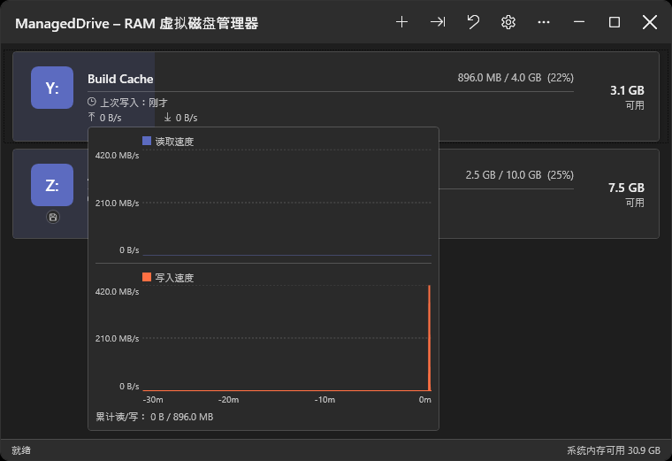
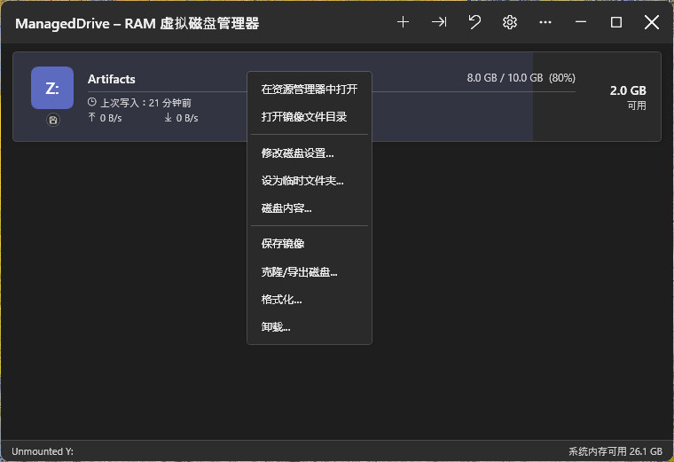
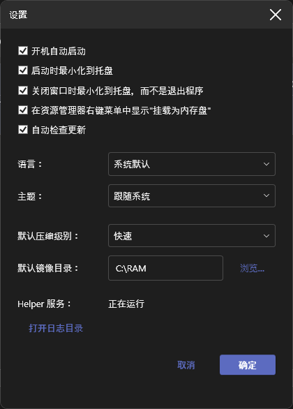
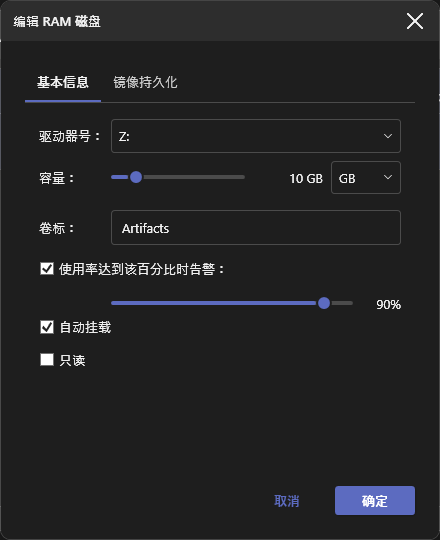
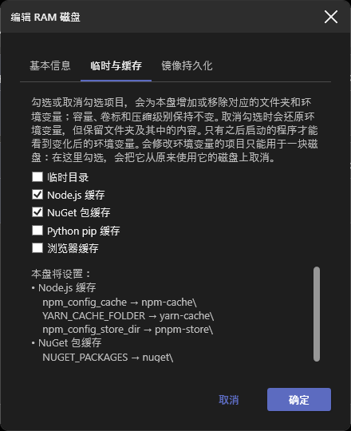
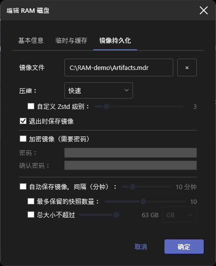

# ManagedDrive

[](https://github.com/coldhighsun/ManagedDrive/actions/workflows/ci.yml)
[](https://codecov.io/gh/coldhighsun/ManagedDrive)
[](https://github.com/coldhighsun/ManagedDrive/releases/latest)
[](https://github.com/coldhighsun/ManagedDrive/releases)
[](https://github.com/coldhighsun/ManagedDrive/releases)
[](https://github.com/coldhighsun/ManagedDrive/issues)
[](https://github.com/coldhighsun/ManagedDrive/pulls)
[](https://github.com/coldhighsun/ManagedDrive/commits/main)
[](https://github.com/coldhighsun/ManagedDrive/stargazers)
[](LICENSE)
[](https://dotnet.microsoft.com/)
[](https://github.com/coldhighsun/ManagedDrive)

[English](README.md) | 中文

---

基于 .NET 10 和 [WinFsp](https://winfsp.dev) 构建的 Windows RAM 虚拟磁盘管理器。  
创建、挂载并管理内存盘，它们在文件资源管理器中以普通驱动器号的形式呈现。

### 软件截图

<p align="center">
  
  
</p>
<p align="center">
  
  
  
  
</p>

### 功能特性

**核心功能**
- 同时挂载多个 RAM 磁盘，各自拥有独立的驱动器号、容量、卷标和只读标志
- 动态内存分配——容量为上限而非预分配；当真正需要分配内存的操作（写入数据、挂载时加载镜像或压缩包、恢复快照、克隆磁盘）会导致宿主机物理内存严重不足时，即使磁盘自身配置的容量还有余量，也会被拒绝
- 实时编辑已挂载磁盘（卷标、容量、自动挂载、镜像路径）；更改盘符或只读标志会自动重挂
- NTFS 兼容，可作为需要 NTFS 卷的工具（WinGet、Windows Update 暂存、BITS）的目标路径
- 支持符号链接和目录联接（pnpm、`git worktree`、构建缓存会用到）以及 `Zone.Identifier` 这类备用数据流；二者都会随镜像和快照保存。不支持硬链接（WinFsp 没有对应的回调）
- 启动时自动挂载已保存的磁盘配置
- **格式化**立即清空磁盘内容（只读磁盘受保护）

**持久化、快照与克隆**
- 保存为 `.mdr` 镜像并在下次挂载时还原，或直接导入已有镜像（**导入磁盘...**）
- 导入压缩包（zip/7z/rar/tar 等 [SharpCompress](https://github.com/adamhathcock/sharpcompress) 支持的格式）为只读磁盘（**导入压缩包...**），容量/卷标自动推算
- 可选自动保存及卸载/退出前的收尾保存；保存采用增量方式，大容量、内容基本未变的磁盘做周期性自动保存依然很快
- 可选镜像压缩级别（Zstd 数字级别：0 为不压缩，1-22，默认 1）
- 按数量/大小上限保留的快照版本历史，内容去重存储；通过**还原快照...**还原
- 克隆磁盘到另一已挂载磁盘，或导出为新 `.mdr` 文件（**克隆磁盘...**）
- 可选 `.mdr` 密码保护（AES-256-GCM）；改密码无需重新加密文件
- 长耗时操作（保存镜像、导入/导出压缩包）显示带进度条的忙碌遮罩

**便利与安全**
- 可选资源管理器右键集成：**"挂载为内存盘 (ManagedDrive)"**菜单项，用于 zip/7z/rar/tar
- 托盘图标带悬浮提示（各盘用量+可用内存）、带每盘子菜单（在资源管理器中打开/保存映像/卸载）的快捷菜单、可选最小化启动；窗口隐藏时通过气泡通知提示磁盘将满、写入被拒绝（磁盘已满/内存不足）、系统内存偏低以及保存失败和恢复
- 状态栏实时显示可用系统内存和最近访问的文件
- 每磁盘可配置高用量警告阈值
- 临时目录重定向到某磁盘的 `Temp` 文件夹（**临时目录**预设）：卸载、退出或崩溃后重启时，TEMP 和 TMP 会恢复为原来的值；TEMP 遗留在内存盘上时启动提示
- **临时与缓存**预设（临时目录、Node.js、NuGet、pip、Go、C/C++ 编译缓存、浏览器缓存），可在同一块盘上叠加：每次挂载时创建对应文件夹，并把相应的用户级环境变量（`TEMP`/`TMP`、`npm_config_cache`、`NUGET_PACKAGES`、`PIP_CACHE_DIR`、`GOCACHE`、`CCACHE_DIR` 等）指向本盘，卸载、退出或取消勾选时还原为你原来的值。可在创建磁盘时勾选（同时自动填入容量和卷标）、在编辑对话框中勾选，或在磁盘右键菜单的**临时与缓存**子菜单里直接勾选（菜单不会关闭，可连续勾选多项）；勾选状态以环境变量的实际指向为准。会修改环境变量的预设只能用于一块磁盘：在另一块盘上选用它，会把它从原来的磁盘上取消（浏览器缓存只创建文件夹，可用于多块盘）
- **还原环境变量**（工具栏按钮和托盘子菜单）：列出当前被重定向的分组（临时目录、Node.js、NuGet、pip、Go、C/C++、其他变量），可单独还原某一组或全部还原为你原来的值，无需卸载磁盘。拥有这些预设的已挂载磁盘会同时关闭对应预设（磁盘上的文件夹和文件保留），因此下次挂载不会再次重定向这些变量；只有之后新启动的程序才会看到变化
- 退出确认并显示保存遮罩直至待处理保存完成
- 双击在资源管理器中打开磁盘；右键提供快捷方式、**磁盘内容...** 或**空间占用分析...**（以矩形树图显示磁盘空间被什么占用，按文件类型着色，并附带占用最大的文件夹/文件/类型列表）

**界面**
- 双语（中/英）及浅色/深色主题，均可自动检测或手动切换
- 磁盘卡片带状态角标（只读、当前临时目录、绑定镜像、密码保护）、使用率进度条，以及实时读写速度曲线图
- 窗口可自由拖拽调整大小
- 关于对话框显示版本、GitHub 链接，有新版本时显示更新链接
- 可选每日检查更新，发现新版本时通知提醒

**命令行**
- `mdrive`（随 `ManagedDrive.exe` 发布）通过命名管道对运行中的应用执行 create/mount/unmount/format/save/set-password/export/list/ls/snapshot/exit，应用未运行时自动启动
- 可挂载到盘符，也可挂载到已存在的空目录（WinFsp 的目录挂载点支持），挂载前会先校验并给出清晰错误提示，而不是原始的驱动状态码

### 安装

```powershell
winget install coldhighsun.ManagedDrive
```

或前往 [Releases](https://github.com/coldhighsun/ManagedDrive/releases) 页面手动下载，每个版本发布了两种安装方式，任选其一：

- `ManagedDrive-Setup-X.Y.Z.exe` —— 引导式安装程序。会自动检测 WinFsp 和 .NET 10 桌面运行时是否已安装，若缺少 WinFsp 会静默安装内置的 WinFsp 安装包，若缺少 .NET 桌面运行时会提示安装，并将 ManagedDrive 安装到 Program Files，创建开始菜单/桌面快捷方式。推荐大多数用户使用。
- `ManagedDrive-vX.Y.Z-win-x64-portable.zip` —— 体积较小；需要单独安装 WinFsp 和 [.NET 10 桌面运行时](https://dotnet.microsoft.com/download/dotnet/10.0)。

若使用 ZIP，解压到任意目录后直接运行 `ManagedDrive.exe` 即可。`ManagedDrive.exe` 是单文件可执行程序——ZIP 中还附带一个体积很小的 `winfsp-msil.dll`（WinFsp 托管互操作程序集，无法打包进单文件中），需与 exe 保持在同一目录下。唯一会写入注册表的操作是可选的"开机自启"设置，除此之外不会写入注册表。使用 ZIP 时仍需提前单独安装 WinFsp（见下方环境要求）；安装程序会自动处理这一步。

ZIP 中还包含 `mdrive.exe`（配套命令行工具，见下方[命令行用法](#cli-usage-zh)）和 `wingetx.exe`（`winget` 包装工具，见下方[wingetx: winget 包装工具](#wingetx-wrapper-zh)）。将解压目录加入 `PATH` 后即可在任意终端中运行 `mdrive`/`wingetx`。安装程序会自动将两者加入系统级 `PATH`。

### 环境要求

| 要求 | 说明 |
|---|---|
| **Windows 10 / 11（64 位）** | 暂未测试 ARM64 |
| **[WinFsp 2.2.26286（2026 Beta5）](https://github.com/winfsp/winfsp/releases/tag/v2.2B5)** | 安装程序已内置，应用在检测到缺失或版本过旧时也会提示自动下载安装（更新版本可直接使用），便携版压缩包的 `prerequisites\` 目录同样附带安装包。如需手动安装，请直接下载安装包：[winfsp-2.2.26286.msi](https://github.com/winfsp/winfsp/releases/download/v2.2B5/winfsp-2.2.26286.msi)——不要使用 `winget install WinFsp.WinFsp` 安装，因为该 winget 包更新不及时，落后于最新发布版本。托管程序集 `winfsp-msil.dll` 将安装至 `C:\Program Files (x86)\WinFsp\bin\`，项目会自动引用。 |
| **[.NET 10 桌面运行时](https://dotnet.microsoft.com/download/dotnet/10.0)** | "绿色版"（框架依赖型）ZIP 需要。 |
| **.NET 10 SDK** | 编译所需。 |

<a id="cli-usage-zh"></a>
### 命令行用法

`mdrive.exe` 随 `ManagedDrive.exe` 一同发布，通过命名管道将命令转发给正在运行的应用，因此脚本无需打开界面即可操作 ManagedDrive。若应用尚未运行，`mdrive` 会自动启动它，并在最长 10 秒内重试。

```powershell
mdrive create R: --capacity-mb 512 --label Scratch --image C:\disks\scratch.mdr
mdrive create R: --preset node --preset nuget
mdrive preset list
mdrive clone R: S:
mdrive edit R: --capacity-mb 1024 --auto-save-minutes 10
mdrive mount C:\disks\scratch.mdr R: --auto-mount --compression 19
mdrive mount C:\disks\scratch.mdr C:\Mounts\Scratch
mdrive list
mdrive list --json
mdrive ls R: \Projects
mdrive ls R: \Projects --json
mdrive info R:
mdrive usage R: --top 20
mdrive save R:
mdrive set-password R: --password-file C:\secrets\scratch.pwd
mdrive export R: C:\backups\scratch.mdr
mdrive export R: C:\backups\scratch.zip --format Zip
mdrive format R: --yes
mdrive snapshot create R:
mdrive snapshot list R:
mdrive snapshot diff R: 1
mdrive snapshot extract R: 1 \Projects\notes.txt C:\restore\notes.txt
mdrive snapshot restore R: 1
mdrive watch --json
mdrive unmount R:
mdrive exit
```

| 命令 | 说明 |
|---|---|
| `create <盘符> [--capacity-mb <数值>] [--preset <id>]... [选项]` | 新建一块全新的空白 RAM 盘。未指定任何 `--preset` 时必须给出 `--capacity-mb`；重复 `--preset` 可在同一块盘上叠加多个预设（容量相加，文件夹和环境变量合并，显式的 `--capacity-mb`/`--label` 优先）。可选项：`--label`（默认 "RAM Disk"）、`--image`（持久化镜像路径；省略则为仅内存磁盘，卸载后即丢弃）、`--password`、`--password-file`（为 `--image` 加密；需配合 `--image` 使用；二者互斥）。`temp` 预设还会把你的用户 TEMP/TMP 指向该磁盘的 `Temp` 文件夹；会修改环境变量的预设会从原来使用它的磁盘上取消。 |
| `preset list` | 列出 `create --preset` 可用的预设：id、名称、容量以及各自设置的环境变量。支持 `--json`。 |
| `clone <源盘符> <目标盘符>` | 用源磁盘的当前内容替换目标磁盘的内容。目标磁盘必须已挂载且可写，容量须不小于源磁盘已用字节数。若宿主机可用内存不足以容纳复制的数据，克隆会失败，目标磁盘保持不变。 |
| `edit <盘符> [选项]` | 对已挂载磁盘应用非破坏性更改。可选项：`--capacity-mb`、`--label`、`--auto-save-minutes`、`--disable-auto-save`（与 `--auto-save-minutes` 互斥）。至少须指定一项。盘符或只读标志的更改需要完整重挂，本命令不支持。 |
| `mount <镜像路径> <盘符> [选项]` | 将已有的 `.mdr` 镜像挂载。`盘符`可以是一个盘符（`R:`），也可以是一个已存在的空目录路径。可选项：`--read-only`、`--auto-mount`、`--auto-save-minutes`、`--compression <0-22>`（Zstd 级别，`0` 为不压缩，`1` 最快、`22` 最小，默认 `1`）、`--max-snapshot-count`、`--max-snapshot-size-mb`、`--high-usage-warn-percent`、`--password`、`--password-file`（二者互斥；仅当镜像已加密时需要——推荐使用 `--password-file`（读取文件首行作为密码）而非 `--password`，以避免密码出现在 shell 历史或进程列表中）。未指定的选项沿用该镜像已保存的配置值（或其默认值）。 |
| `mount-archive <压缩包路径> [盘符]` | 将压缩包（zip/7z/rar/tar 等）作为只读磁盘导入挂载，挂载完成后会自动在资源管理器中打开该盘符。`盘符`可以是一个盘符，也可以是一个已存在的空目录路径；完全省略时自动从 `Z:` 向下查找第一个可用盘符。资源管理器右键菜单项内部即调用此命令。 |
| `unmount <盘符>` | 卸载已挂载的磁盘。 |
| `format <盘符> --yes` | 清空已挂载磁盘上的所有文件，须加 `--yes`/`-y` 确认。 |
| `save <盘符>` | 立即将已挂载磁盘的内容保存到其绑定的镜像文件。 |
| `set-password <盘符> [选项]` | 设置或移除已挂载磁盘的加密密码，下次保存时生效。`--password`、`--password-file`（读取文件首行作为密码，推荐使用以避免密码出现在 shell 历史或进程列表中）、`--remove`（移除密码保护）三者须指定且只能指定一个。 |
| `export <盘符> <输出路径> [选项]` | 将已挂载磁盘导出为独立的 `.mdr` 镜像或压缩包文件，不影响该磁盘自身的持久化配置。可选项：`--format <Zip\|SevenZip>`（导出为压缩包而非 `.mdr` 镜像）、`--compression <级别>`（`0` 为不压缩；`.mdr` 为 Zstd `1`-`22`，`--format` 压缩包为 `1`-`9`；默认 `1`）、`--password`、`--password-file`（为导出的 `.mdr` 镜像加密；与 `--format` 互斥，因为压缩包格式不支持加密）、`--force`/`-f`（覆盖已存在的输出文件；不加时目标文件已存在会报错）。输出路径不能是已挂载磁盘自身的镜像、快照文件名，也不能位于 RAM 盘上。 |
| `list` | 列出当前已挂载的磁盘及其用量与容量。 |
| `ls <盘符> [路径]` | 列出已挂载磁盘上某目录的直接子项（名称、类型、大小）。`路径`（如 `\Folder`）省略时列出根目录。 |
| `info <盘符>` | 显示已挂载磁盘的配置与状态：用量、是否只读、镜像路径、是否加密、自动保存间隔、压缩级别、快照上限与数量、上次保存时间。 |
| `usage <盘符> [--top N] [--by dir\|file\|ext]` | 显示已挂载磁盘的内存都用在了哪里：占用最大的目录（含其下全部内容）、最大的文件（备用数据流计入所属文件）和占用最大的扩展名，并给出各自占已用内存的比例。`--top`（1-1000，默认 10）设置列表长度；`--by` 只输出其中一个列表；加 `--json` 时输出全部三个列表。 |
| `watch` | 实时输出磁盘事件——`mounted`、`unmounted`、`save-completed`、`save-failed`、`high-usage`——直到按 Ctrl+C 中断。不会阻塞其他 `mdrive` 命令；同时最多运行两个 watch。加 `--json` 时每行输出一个 JSON 对象。 |
| `snapshot create <盘符>` | 立即为已挂载磁盘写入一个带时间戳的快照，独立于常规保存。需要该磁盘已配置镜像路径及快照保留策略（`--max-snapshot-count`/`--max-snapshot-size-mb`）。 |
| `snapshot list <盘符>` | 列出已挂载磁盘的快照，按时间倒序排列（序号 1 为最新）。 |
| `snapshot diff <盘符> <序号>` | 将指定快照与磁盘当前实际内容进行比较，列出新增/删除/修改的文件和目录。 |
| `snapshot extract <盘符> <序号> <快照内路径> <输出路径> [--force]` | 把快照中的某个文件或整个目录树复制到宿主机，不影响磁盘本身。文件写到`输出路径`（若它是已存在的目录则写入其中）；目录则把其内容写入`输出路径`。若会覆盖已有文件则一个也不写，除非加 `--force`/`-f`。备用数据流和符号链接/联接不会被复制。执行期间会把整个快照载入内存。 |
| `snapshot restore <盘符> <序号>` | 用指定序号的快照恢复已挂载磁盘的内容，会替换当前内容。 |
| `snapshot delete <盘符> <序号>` | 删除已挂载磁盘的某个快照。 |
| `exit` | 退出正在运行的 ManagedDrive 应用。 |

所有命令都接受全局选项 `--json`，以 JSON 而非文本输出结果：`ls`、`list`、`info`、`snapshot list`、`snapshot diff` 输出其数据，其余命令输出 `{ "Success", "Message" }`，退出码不变。参数错误和 `--help` 始终是纯文本。

运行 `mdrive --help` 或 `mdrive <命令> --help` 可查看完整的选项列表。

<a id="wingetx-wrapper-zh"></a>
### wingetx: winget 包装工具

`wingetx.exe` 是 `winget` 的透明包装工具，随 `ManagedDrive.exe`/`mdrive.exe` 一同发布。可直接把它当作 `winget` 的替代品使用：

```powershell
wingetx install <包名>
wingetx upgrade <包名>
```

如果 `%TEMP%` 当前不在 ManagedDrive 内存盘上，或所调用的子命令不是 `install`/`upgrade`，`wingetx` 会原样把调用转发给 `winget.exe`——因此把 `winget` 直接别名为 `wingetx` 始终是安全的。

当 `%TEMP%` **确实**设为 ManagedDrive 内存盘时，`wingetx install`/`wingetx upgrade` 会将 MSI 及 exe 类型的包改为先执行 `winget download`，再手动启动下载好的安装程序（MSI/WiX 用 `msiexec`，其余直接运行安装包本身），而不是直接执行 `winget install`。这样可以绕开下方[已知问题](#known-issues-zh)中描述的两种失败模式：`msiexec` 的卷装载管理器（Mount Manager）源卷检查，以及影响 exe 安装包的跨会话退出码 1 问题。它无法确信处理的安装包类型（msix、appx、zip、便携版等）会自动转发给普通的 `winget install`/`upgrade`。

- 除非传入 `--silent` 或 `--disable-interactivity`，安装程序界面默认保持可见（`SilentWithProgress` 开关），与 `winget` 自身行为一致。
- 下载的安装包会先暂存到 `%LOCALAPPDATA%\Temp\wingetx`（一个真实的、非 WinFsp 的卷）再启动。

<a id="known-issues-zh"></a>
### 已知问题

#### 将 TEMP 设为内存盘后，某些安装包可能报错

WinFsp 把盘符挂载在**当前登录会话（logon session）**的设备命名空间中，因此其他会话或登录令牌下的进程（session 0 的系统服务、或提权后跑在链接管理员令牌下的进程）无法解析该盘符，由此产生两种失败模式：

1. **跨会话盘符可见性**——系统级进程（如 winget 的软件包管理器服务）从 `Z:\Temp\...\setup.exe` 启动时看不到该盘，报 `0x800704b3`（*网络路径未找到*）。已知受影响：**WeChatWin\_\*.exe**（微信）、**7z\*.exe**（7-Zip）、**Git-\*.exe**（Git）。可由下方可选的 SYSTEM 辅助服务解决——它会为该盘发布一个全局（`\GLOBAL??`）符号链接。
2. **通过 Windows Installer 服务安装的 MSI**——`msiexec` 以 SYSTEM 身份跑在 session 0 的那一半，在读取源文件前会对源卷做一次卷身份查询（询问 Mount Manager）；WinFsp 的 per-session 挂载没有在 Mount Manager 里注册，所以该查询以系统错误 `1005` 失败 → MSI 错误 `2755`/`1603`。辅助服务的符号链接修不了这个——卷依然不是 Mount-Manager 注册的系统卷。影响 `winget` 安装 MSI 包及源文件位于内存盘上的独立 `.msi` 文件；根治需要改为通过 Windows Mount Manager 挂载（更大的服务化挂载重构），不在辅助服务的能力范围内。

**可选 SYSTEM 辅助服务**（`ManagedDriveHelper`）通过为当前 TEMP 目标盘发布跨会话全局符号链接来解决失败模式 1，对失败模式 2 无效。

- 安装包版本（`ManagedDrive-Setup-*.exe`）会自动注册/移除该服务，无需手动操作。
- 便携式 ZIP：需自己在解压目录下打开管理员终端手动执行：
  ```
  sc create ManagedDriveHelper binPath= "%cd%\ManagedDriveHelper.exe" start= auto
  sc start ManagedDriveHelper
  ```
  之后可用 `sc stop ManagedDriveHelper` 再 `sc delete ManagedDriveHelper` 移除。完全是可选的——不做这一步 ManagedDrive 照常挂载和使用，只是失败模式 1 得不到解决。

**MSI 安装的解决办法：** 安装 MSI 类软件前，先点工具栏的**还原环境变量**按钮并选择**临时目录**来恢复 TEMP（或在该磁盘右键菜单的**临时与缓存**里取消勾选**临时目录**）再重试；或直接前往官网下载安装包手动安装；也可以用 [`wingetx`](#wingetx-wrapper-zh) 代替 `winget`——它无需重置 TEMP 即可绕开上述两种失败模式。

ManagedDrive 会在 TEMP 被设为内存盘时提示一次，此后只要 TEMP 仍指向内存盘，每次启动都会再次提示——恢复默认值即可停止。

### 配置与持久化

- 配置以 JSON 格式存储于 `%APPDATA%\ManagedDrive\settings.json`，包括每个磁盘各自的高用量告警阈值（或已禁用状态）。
- 开机自启通过 `HKCU\SOFTWARE\Microsoft\Windows\CurrentVersion\Run` 注册表项实现（无需提升权限）。
- 版本号由 MinVer 从 git 标签派生（`v` 前缀，例如 `v0.1.0`）。

## 开发者内容

构建说明、解决方案结构、内部实现和性能基准见 [DEVELOPMENT.md](docs/DEVELOPMENT.md)。

### 许可证

MIT

本项目内置了 [WinFsp](https://winfsp.dev/) 和 [SharpCompress](https://github.com/adamhathcock/sharpcompress)，其版权与许可证信息见 [THIRD-PARTY-NOTICES.md](docs/THIRD-PARTY-NOTICES.md)。
