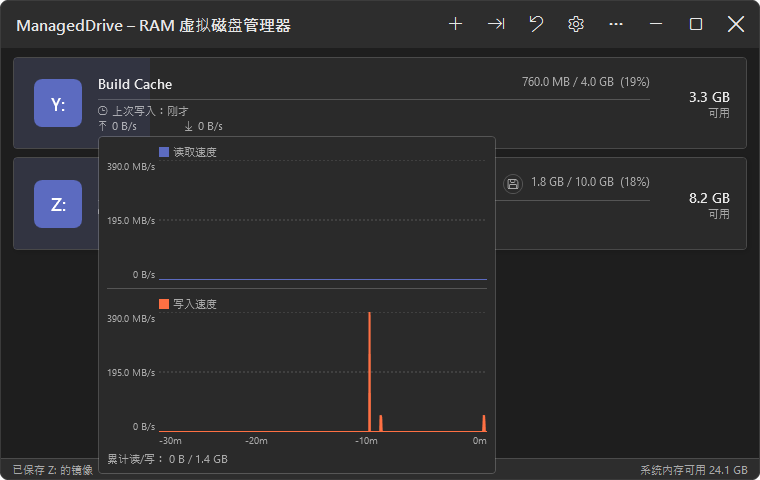
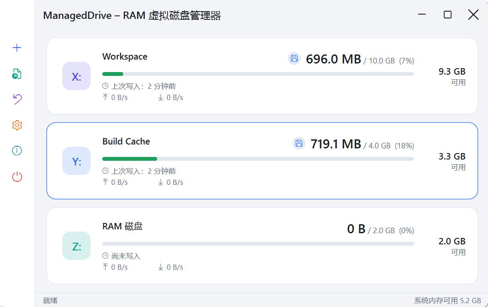
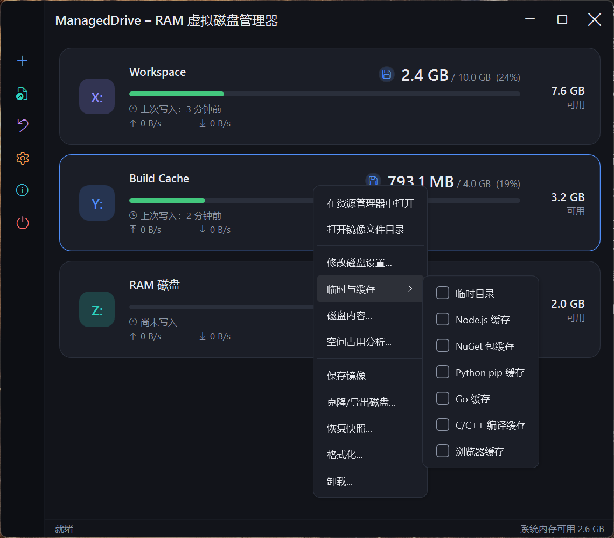
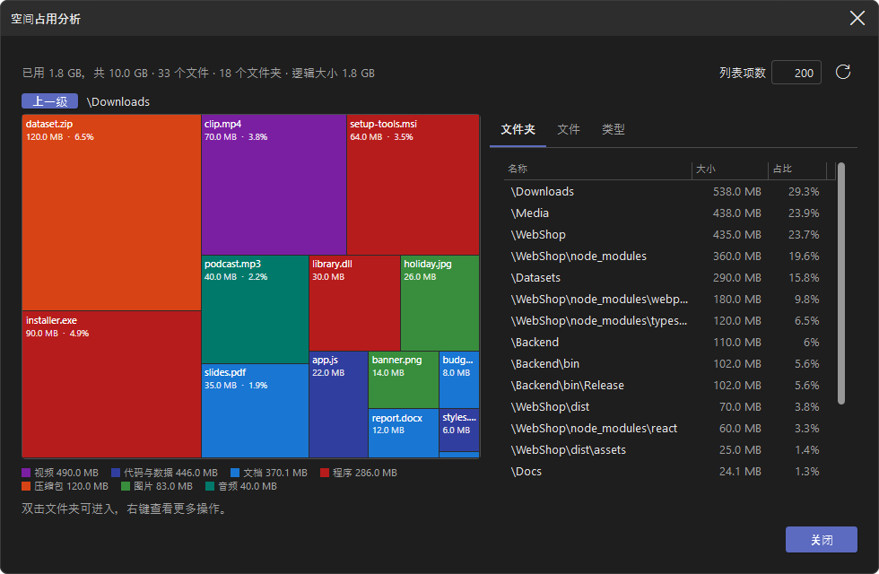
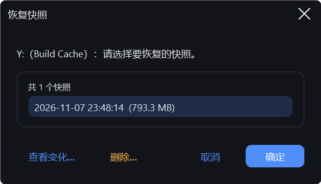
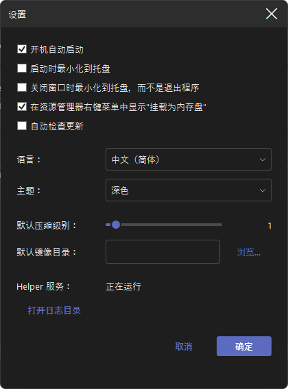
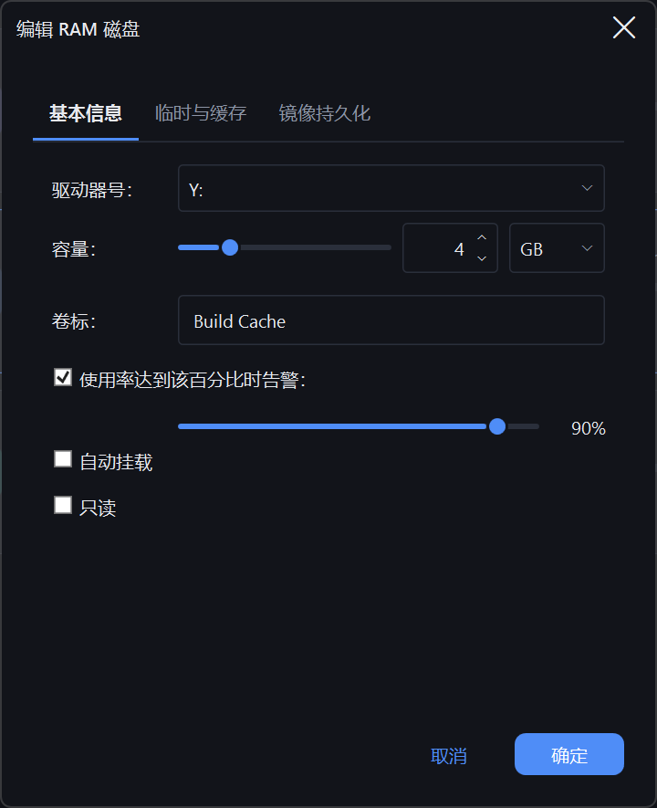
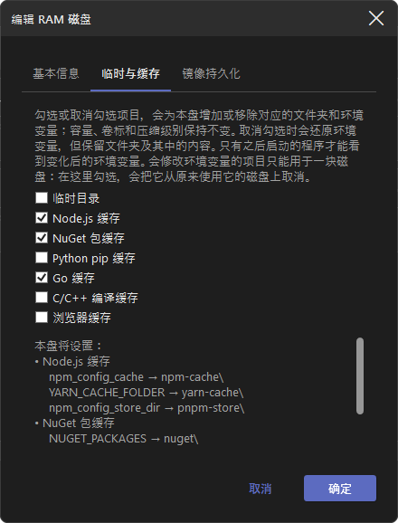
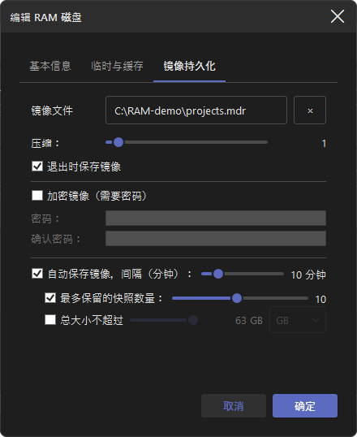

# ManagedDrive

[](https://github.com/coldhighsun/ManagedDrive/actions/workflows/ci.yml)
[](https://codecov.io/gh/coldhighsun/ManagedDrive)
[](https://github.com/coldhighsun/ManagedDrive/releases/latest)
[](https://github.com/coldhighsun/ManagedDrive/releases)
[](https://github.com/microsoft/winget-pkgs/tree/master/manifests/c/coldhighsun/ManagedDrive)
[](https://github.com/coldhighsun/ManagedDrive/releases)
[](https://github.com/coldhighsun/ManagedDrive/issues)
[](https://github.com/coldhighsun/ManagedDrive/pulls)
[](https://github.com/coldhighsun/ManagedDrive/commits/main)
[](https://github.com/coldhighsun/ManagedDrive/stargazers)
[](LICENSE)
[](https://dotnet.microsoft.com/)
[](https://github.com/coldhighsun/ManagedDrive)

[English](README.md) | [简体中文](README.zh-CN.md) | 繁體中文

---

以 .NET 10 和 [WinFsp](https://winfsp.dev) 建置的 Windows RAM 虛擬磁碟管理員。  
建立、掛載並管理記憶體磁碟，它們在檔案總管中會以一般磁碟機代號的形式呈現。

### 軟體截圖

以下截圖為簡體中文介面。

<p align="center">
  
  
</p>
<p align="center">
  
  
</p>
<p align="center">
  
  
</p>
<p align="center">
  
  
  
  
</p>

### 功能特色

**核心功能**
- 同時掛載多個 RAM 磁碟，各自擁有獨立的磁碟機代號、容量、磁碟區標籤和唯讀旗標
- 動態記憶體配置——容量為上限而非預先配置；當真正需要配置記憶體的操作（寫入資料、掛載時載入映像檔或壓縮檔、還原快照、複製磁碟）會導致主機實體記憶體嚴重不足時，即使磁碟本身設定的容量還有餘裕，也會被拒絕
- 即時編輯已掛載的磁碟（磁碟區標籤、容量、自動掛載、映像檔路徑）；變更磁碟機代號或唯讀旗標會自動重新掛載
- 相容 NTFS，可作為需要 NTFS 磁碟區的工具（WinGet、Windows Update 暫存、BITS）的目標路徑
- 支援符號連結和目錄連接點（pnpm、`git worktree`、建置快取會用到）以及 `Zone.Identifier` 這類替代資料流；兩者都會隨映像檔和快照一併儲存。不支援硬連結（WinFsp 沒有對應的回呼）
- 啟動時自動掛載已儲存的磁碟設定
- **格式化**會立即清空磁碟內容，並刪除其映像檔和全部快照（唯讀磁碟受到保護）

**持久化、快照與複製**
- 儲存為 `.mdr` 映像檔並在下次掛載時還原，或直接匯入現有的映像檔（**匯入磁碟...**）
- 將壓縮檔（zip/7z/rar/tar 等 [SharpCompress](https://github.com/adamhathcock/sharpcompress) 支援的格式）匯入為唯讀磁碟（**匯入壓縮檔...**），容量/磁碟區標籤自動推算
- 可選用自動儲存，以及卸載/結束前的收尾儲存；儲存採用增量方式，大容量、內容幾乎沒有變動的磁碟做定時自動儲存依然很快
- 可選擇映像檔壓縮等級（Zstd 數字等級：0 為不壓縮，1-22，預設 1）
- 依數量/大小上限保留的快照版本歷程，內容去重複儲存；透過**還原快照...**還原
- 將磁碟複製到另一個已掛載的磁碟，或匯出為新的 `.mdr` 檔案（**複製磁碟...**）
- 可選用 `.mdr` 密碼保護（AES-256-GCM）；變更密碼不需要重新加密檔案
- 耗時較長的操作（儲存映像檔、匯入/匯出壓縮檔）會顯示附有進度列的忙碌遮罩

**便利與安全**
- 可選用檔案總管右鍵整合：針對 zip/7z/rar/tar 提供**「掛載為記憶體磁碟 (ManagedDrive)」**選單項目
- 系統匣圖示附有浮動提示（各磁碟用量與可用記憶體）、附有各磁碟子選單（在檔案總管中開啟/儲存映像檔/卸載）的快顯選單、可選擇最小化啟動；視窗隱藏時，會透過氣球通知提示磁碟即將已滿、寫入被拒絕（磁碟已滿/記憶體不足）、系統記憶體偏低，以及儲存失敗和恢復
- 狀態列即時顯示可用的系統記憶體和最近存取的檔案
- 每個磁碟可各自設定高用量警告臨界值
- 將暫存資料夾重新導向到某個磁碟的 `Temp` 資料夾（**暫存資料夾**預設）：卸載、結束或當機後重新啟動時，TEMP 和 TMP 會還原為原本的值；TEMP 遺留在記憶體磁碟上時，啟動會提示
- **暫存與快取**預設（暫存資料夾、Node.js、NuGet、pip、Go、C/C++ 編譯快取、瀏覽器快取），可在同一個磁碟上疊加：每次掛載時建立對應資料夾，並把相應的使用者層級環境變數（`TEMP`/`TMP`、`npm_config_cache`、`NUGET_PACKAGES`、`PIP_CACHE_DIR`、`GOCACHE`、`CCACHE_DIR` 等）指向此磁碟，卸載、結束或取消勾選時還原為您原本的值。可在建立磁碟時勾選（同時自動填入容量和磁碟區標籤）、在編輯對話方塊中勾選，或在磁碟右鍵選單的**暫存與快取**子選單裡直接勾選（選單不會關閉，可連續勾選多項）；勾選狀態以環境變數實際的指向為準。會修改環境變數的預設只能用於一個磁碟：在另一個磁碟上選用它，會把它從原本的磁碟上取消（瀏覽器快取只建立資料夾，可用於多個磁碟）
- **還原環境變數**（工具列按鈕和系統匣子選單）：列出目前被重新導向的群組（暫存資料夾、Node.js、NuGet、pip、Go、C/C++、其他變數），可單獨還原某一組或全部還原為您原本的值，不需要卸載磁碟。擁有這些預設的已掛載磁碟會同時關閉對應預設（磁碟上的資料夾和檔案會保留），因此下次掛載時不會再重新導向這些變數；只有之後新啟動的程式才會看到變更
- 結束前會要求確認，並顯示儲存遮罩直到待處理的儲存完成
- 按兩下即可在檔案總管中開啟磁碟；按右鍵可使用快速操作、**磁碟內容...** 或**空間使用分析...**（以矩形樹狀圖顯示磁碟空間被什麼占用，依檔案類型著色，並附上占用最大的資料夾/檔案/類型清單）

**介面**
- 支援英文、簡體中文與繁體中文，並提供淺色/深色佈景主題，均可自動偵測或手動切換
- 磁碟卡片附有狀態徽章（唯讀、目前的暫存資料夾、已繫結映像檔、密碼保護）、使用率進度列，以及即時讀寫速度曲線圖
- 視窗可自由拖曳調整大小
- 「關於」對話方塊顯示版本、GitHub 連結，有新版本時顯示更新連結
- 可選用每日檢查更新，發現新版本時通知提醒

**命令列**
- `mdrive`（隨 `ManagedDrive.exe` 一併發行）透過具名管道，對執行中的應用程式執行 create/mount/unmount/format/save/set-password/export/list/ls/snapshot/exit，應用程式未執行時會自動啟動
- 可掛載到磁碟機代號，也可掛載到已存在的空資料夾（WinFsp 的資料夾掛載點支援），掛載前會先驗證並給出清楚的錯誤訊息，而不是原始的驅動程式狀態碼

### 安裝

```powershell
winget install coldhighsun.ManagedDrive
```

或前往 [Releases](https://github.com/coldhighsun/ManagedDrive/releases) 頁面手動下載，每個版本提供兩種安裝方式，擇一即可：

- `ManagedDrive-Setup-X.Y.Z.exe` —— 引導式安裝程式。會自動偵測 WinFsp 和 .NET 10 桌面執行階段是否已安裝，若缺少 WinFsp 會靜默安裝內建的 WinFsp 安裝套件，若缺少 .NET 桌面執行階段會提示安裝，並將 ManagedDrive 安裝到 Program Files，建立開始功能表/桌面捷徑。推薦大多數使用者使用。
- `ManagedDrive-vX.Y.Z-win-x64-portable.zip` —— 體積較小；需要另外安裝 WinFsp 和 [.NET 10 桌面執行階段](https://dotnet.microsoft.com/download/dotnet/10.0)。

若使用 ZIP，解壓縮到任意資料夾後直接執行 `ManagedDrive.exe` 即可。`ManagedDrive.exe` 是單一檔案的可執行程式——ZIP 中還附有一個體積很小的 `winfsp-msil.dll`（WinFsp 的受控互通組件，無法封裝進單一檔案中），需與 exe 放在同一個資料夾。唯一會寫入登錄的操作是選用的「開機自動啟動」設定，除此之外不會寫入登錄。使用 ZIP 時仍需事先另外安裝 WinFsp（見下方環境需求）；安裝程式會自動處理這一步。

ZIP 中還包含 `mdrive.exe`（配套的命令列工具，見下方[命令列用法](#cli-usage-zh-tw)）和 `wingetx.exe`（`winget` 包裝工具，見下方[wingetx: winget 包裝工具](#wingetx-wrapper-zh-tw)）。將解壓縮的資料夾加入 `PATH` 後，即可在任何終端機中執行 `mdrive`/`wingetx`。安裝程式會自動將兩者加入系統層級的 `PATH`。

### 環境需求

| 需求 | 說明 |
|---|---|
| **Windows 10 / 11（64 位元）** | 尚未測試 ARM64 |
| **[WinFsp 2.2.26286（2026 Beta5）](https://github.com/winfsp/winfsp/releases/tag/v2.2B5)** | 安裝程式已內建，應用程式偵測到缺少或版本過舊時也會提示自動下載安裝（較新的版本可直接使用），可攜版壓縮檔的 `prerequisites\` 資料夾同樣附有安裝套件。如需手動安裝，請直接下載安裝套件：[winfsp-2.2.26286.msi](https://github.com/winfsp/winfsp/releases/download/v2.2B5/winfsp-2.2.26286.msi)——請不要使用 `winget install WinFsp.WinFsp` 安裝，因為該 winget 套件更新不及時，落後於最新發行版本。受控組件 `winfsp-msil.dll` 會安裝至 `C:\Program Files (x86)\WinFsp\bin\`，專案會自動參考。 |
| **[.NET 10 桌面執行階段](https://dotnet.microsoft.com/download/dotnet/10.0)** | 「免安裝版」（相依於 Framework）ZIP 需要。 |
| **.NET 10 SDK** | 編譯所需。 |

<a id="cli-usage-zh-tw"></a>
### 命令列用法

`mdrive.exe` 隨 `ManagedDrive.exe` 一併發行，透過具名管道將命令轉送給正在執行的應用程式，因此指令碼不需要開啟介面就能操作 ManagedDrive。若應用程式尚未執行，`mdrive` 會自動啟動它，並在最長 10 秒內重試。

```powershell
mdrive create R: --capacity-mb 512 --label Scratch --image C:\disks\scratch.mdr
mdrive create R: --preset node --preset nuget
mdrive preset list
mdrive clone R: S:
mdrive edit R: --capacity-mb 1024 --auto-save-minutes 10
mdrive mount C:\disks\scratch.mdr R: --auto-mount --compression 19
mdrive mount C:\disks\scratch.mdr C:\Mounts\Scratch
mdrive list
mdrive list --json
mdrive ls R: \Projects
mdrive ls R: \Projects --json
mdrive info R:
mdrive usage R: --top 20
mdrive save R:
mdrive set-password R: --password-file C:\secrets\scratch.pwd
mdrive export R: C:\backups\scratch.mdr
mdrive export R: C:\backups\scratch.zip --format Zip
mdrive format R: --yes
mdrive snapshot create R:
mdrive snapshot list R:
mdrive snapshot diff R: 1
mdrive snapshot extract R: 1 \Projects\notes.txt C:\restore\notes.txt
mdrive snapshot restore R: 1
mdrive watch --json
mdrive unmount R:
mdrive exit
```

| 命令 | 說明 |
|---|---|
| `create <磁碟機代號> [--capacity-mb <數值>] [--preset <id>]... [選項]` | 建立一個全新的空白 RAM 磁碟。未指定任何 `--preset` 時必須給定 `--capacity-mb`；重複 `--preset` 可在同一個磁碟上疊加多個預設（容量相加，資料夾和環境變數合併，明確指定的 `--capacity-mb`/`--label` 優先）。可用選項：`--label`（預設 "RAM Disk"）、`--image`（持久化映像檔路徑；省略則為僅存在於記憶體的磁碟，卸載後即捨棄）、`--password`、`--password-file`（為 `--image` 加密；需搭配 `--image` 使用；兩者互斥）。`temp` 預設還會把您的使用者 TEMP/TMP 指向該磁碟的 `Temp` 資料夾；會修改環境變數的預設會從原本使用它的磁碟上取消。 |
| `preset list` | 列出 `create --preset` 可用的預設：id、名稱、容量以及各自設定的環境變數。支援 `--json`。 |
| `clone <來源磁碟機代號> <目標磁碟機代號>` | 以來源磁碟目前的內容取代目標磁碟的內容。目標磁碟必須已掛載且可寫入，容量須不小於來源磁碟已使用的位元組數。若主機可用記憶體不足以容納複製的資料，複製會失敗，目標磁碟保持不變。 |
| `edit <磁碟機代號> [選項]` | 對已掛載的磁碟套用非破壞性的變更。可用選項：`--capacity-mb`、`--label`、`--auto-save-minutes`、`--disable-auto-save`（與 `--auto-save-minutes` 互斥）。至少須指定一項。磁碟機代號或唯讀旗標的變更需要完整重新掛載，本命令不支援。 |
| `mount <映像檔路徑> <磁碟機代號> [選項]` | 掛載現有的 `.mdr` 映像檔。`磁碟機代號`可以是一個磁碟機代號（`R:`），也可以是一個已存在的空資料夾路徑。可用選項：`--read-only`、`--auto-mount`、`--auto-save-minutes`、`--compression <0-22>`（Zstd 等級，`0` 為不壓縮，`1` 最快、`22` 最小，預設 `1`）、`--max-snapshot-count`、`--max-snapshot-size-mb`、`--high-usage-warn-percent`、`--password`、`--password-file`（兩者互斥；僅在映像檔已加密時需要——建議使用 `--password-file`（讀取檔案第一行作為密碼）而非 `--password`，以避免密碼出現在 shell 歷程或處理序清單中）。未指定的選項沿用該映像檔已儲存的設定值（或其預設值）。 |
| `mount-archive <壓縮檔路徑> [磁碟機代號]` | 將壓縮檔（zip/7z/rar/tar 等）匯入並掛載為唯讀磁碟，掛載完成後會自動在檔案總管中開啟該磁碟機。`磁碟機代號`可以是一個磁碟機代號，也可以是一個已存在的空資料夾路徑；完全省略時會自動從 `Z:` 往下尋找第一個可用的磁碟機代號。檔案總管的右鍵選單項目內部即呼叫此命令。 |
| `unmount <磁碟機代號>` | 卸載已掛載的磁碟。 |
| `format <磁碟機代號> --yes` | 清空已掛載磁碟上的所有檔案，並刪除其映像檔和全部快照（若映像檔路徑在上次儲存後改過，也會刪除上次儲存的映像檔，除非另一個已掛載的磁碟或已儲存的磁碟設定正在使用它），輸出中會說明哪些映像檔被重設或刪除，須加上 `--yes`/`-y` 確認。 |
| `save <磁碟機代號>` | 立即將已掛載磁碟的內容儲存到其繫結的映像檔。 |
| `set-password <磁碟機代號> [選項]` | 設定或移除已掛載磁碟的加密密碼，下次儲存時生效。`--password`、`--password-file`（讀取檔案第一行作為密碼，建議使用以避免密碼出現在 shell 歷程或處理序清單中）、`--remove`（移除密碼保護）三者須指定且只能指定一個。 |
| `export <磁碟機代號> <輸出路徑> [選項]` | 將已掛載的磁碟匯出為獨立的 `.mdr` 映像檔或壓縮檔，不影響該磁碟本身的持久化設定。可用選項：`--format <Zip\|SevenZip>`（匯出為壓縮檔而非 `.mdr` 映像檔）、`--compression <等級>`（`0` 為不壓縮；`.mdr` 為 Zstd `1`-`22`，`--format` 壓縮檔為 `1`-`9`；預設 `1`）、`--password`、`--password-file`（為匯出的 `.mdr` 映像檔加密；與 `--format` 互斥，因為壓縮檔格式不支援加密）、`--force`/`-f`（覆寫已存在的輸出檔案；未加時目標檔案已存在會回報錯誤）。輸出路徑不能是已掛載磁碟本身的映像檔、快照檔名，也不能位於 RAM 磁碟上。 |
| `list` | 列出目前已掛載的磁碟及其用量與容量。 |
| `ls <磁碟機代號> [路徑]` | 列出已掛載磁碟上某資料夾的直接子項目（名稱、類型、大小）。`路徑`（如 `\Folder`）省略時列出根目錄。 |
| `info <磁碟機代號>` | 顯示已掛載磁碟的設定與狀態：用量、是否唯讀、映像檔路徑、是否加密、自動儲存間隔、壓縮等級、快照上限與數量、上次儲存時間。 |
| `usage <磁碟機代號> [--top N] [--by dir\|file\|ext]` | 顯示已掛載磁碟的記憶體都用在哪裡：占用最大的資料夾（含其下全部內容）、最大的檔案（替代資料流計入所屬檔案）和占用最大的副檔名，並給出各自占已使用記憶體的比例。`--top`（1-1000，預設 10）設定清單長度；`--by` 只輸出其中一個清單；加上 `--json` 時輸出全部三個清單。 |
| `watch` | 即時輸出磁碟事件——`mounted`、`unmounted`、`save-completed`、`save-failed`、`high-usage`——直到按 Ctrl+C 中斷。不會阻擋其他 `mdrive` 命令；同時最多執行兩個 watch。加上 `--json` 時每行輸出一個 JSON 物件。 |
| `snapshot create <磁碟機代號>` | 立即為已掛載的磁碟寫入一個附有時間戳記的快照，獨立於一般儲存。需要該磁碟已設定映像檔路徑及快照保留原則（`--max-snapshot-count`/`--max-snapshot-size-mb`）。 |
| `snapshot list <磁碟機代號>` | 列出已掛載磁碟的快照，依時間由新到舊排列（編號 1 為最新）。 |
| `snapshot diff <磁碟機代號> <編號>` | 將指定快照與磁碟目前實際的內容比較，列出新增/刪除/修改的檔案和資料夾。 |
| `snapshot extract <磁碟機代號> <編號> <快照內路徑> <輸出路徑> [--force]` | 把快照中的某個檔案或整個資料夾樹複製到主機，不影響磁碟本身。檔案會寫到`輸出路徑`（若它是已存在的資料夾則寫入其中）；資料夾則把其內容寫入`輸出路徑`。若會覆寫既有檔案則一個也不寫，除非加上 `--force`/`-f`。替代資料流和符號連結/連接點不會被複製。執行期間會把整個快照載入記憶體。 |
| `snapshot restore <磁碟機代號> <編號>` | 以指定編號的快照還原已掛載磁碟的內容，會取代目前的內容。 |
| `snapshot delete <磁碟機代號> <編號>` | 刪除已掛載磁碟的某個快照。 |
| `exit` | 結束正在執行的 ManagedDrive 應用程式。 |

所有命令都接受全域選項 `--json`，以 JSON 而非文字輸出結果：`ls`、`list`、`info`、`snapshot list`、`snapshot diff` 輸出其資料，其餘命令輸出 `{ "Success", "Message" }`，結束代碼不變。參數錯誤和 `--help` 一律為純文字。

執行 `mdrive --help` 或 `mdrive <命令> --help` 可查看完整的選項清單。

<a id="wingetx-wrapper-zh-tw"></a>
### wingetx: winget 包裝工具

`wingetx.exe` 是 `winget` 的透明包裝工具，隨 `ManagedDrive.exe`/`mdrive.exe` 一併發行。可直接把它當作 `winget` 的替代品使用：

```powershell
wingetx install <套件名稱>
wingetx upgrade <套件名稱>
```

如果 `%TEMP%` 目前不在 ManagedDrive 記憶體磁碟上，或所呼叫的子命令不是 `install`/`upgrade`，`wingetx` 會原樣把呼叫轉送給 `winget.exe`——因此直接把 `winget` 設為 `wingetx` 的別名永遠是安全的。

當 `%TEMP%` **確實**設為 ManagedDrive 記憶體磁碟時，`wingetx install`/`wingetx upgrade` 會將 MSI 及 exe 類型的套件改為先執行 `winget download`，再手動啟動下載好的安裝程式（MSI/WiX 使用 `msiexec`，其餘直接執行安裝套件本身），而不是直接執行 `winget install`。這樣可以避開下方[已知問題](#known-issues-zh-tw)中描述的兩種失敗模式：`msiexec` 的磁碟區掛載管理員（Mount Manager）來源磁碟區檢查，以及影響 exe 安裝套件的跨工作階段結束代碼 1 問題。對於無法確定如何處理的安裝套件類型（msix、appx、zip、可攜版等），會自動轉送給一般的 `winget install`/`upgrade`。

- 除非傳入 `--silent` 或 `--disable-interactivity`，安裝程式介面預設會保持可見（`SilentWithProgress` 開關），與 `winget` 本身的行為一致。
- 下載的安裝套件會先暫存到 `%LOCALAPPDATA%\Temp\wingetx`（一個真實的、非 WinFsp 的磁碟區）再啟動。

<a id="known-issues-zh-tw"></a>
### 已知問題

#### 將 TEMP 設為記憶體磁碟後，某些安裝程式可能會發生錯誤

WinFsp 把磁碟機代號掛載在**目前登入工作階段（logon session）**的裝置命名空間中，因此其他工作階段或登入權杖下的處理序（session 0 的系統服務，或提升權限後以連結的系統管理員權杖執行的處理序）無法解析該磁碟機代號，由此產生兩種失敗模式：

1. **跨工作階段的磁碟機代號可見性**——系統層級的處理序（如 winget 的封裝管理員服務）從 `Z:\Temp\...\setup.exe` 啟動時看不到該磁碟，會回報 `0x800704b3`（*找不到網路路徑*）。已知受影響的有：**WeChatWin\_\*.exe**（微信）、**7z\*.exe**（7-Zip）、**Git-\*.exe**（Git）。可由下方選用的 SYSTEM 輔助服務解決——它會為該磁碟發佈一個全域（`\GLOBAL??`）符號連結。
2. **透過 Windows Installer 服務安裝的 MSI**——`msiexec` 以 SYSTEM 身分執行在 session 0 的那一半，在讀取來源檔案前會對來源磁碟區做一次磁碟區身分查詢（詢問 Mount Manager）；WinFsp 的 per-session 掛載沒有在 Mount Manager 中註冊，所以該查詢會以系統錯誤 `1005` 失敗 → MSI 錯誤 `2755`/`1603`。輔助服務的符號連結無法解決這個問題——該磁碟區依然不是向 Mount Manager 註冊的系統磁碟區。影響 `winget` 安裝 MSI 套件，以及來源檔案位於記憶體磁碟上的獨立 `.msi` 檔案；根本的解決方式是改為透過 Windows Mount Manager 掛載（較大幅度的服務化掛載重構），不在輔助服務的能力範圍內。

**選用的 SYSTEM 輔助服務**（`ManagedDriveHelper`）透過為目前 TEMP 目標磁碟發佈跨工作階段的全域符號連結來解決失敗模式 1，對失敗模式 2 無效。

- 安裝程式版本（`ManagedDrive-Setup-*.exe`）會自動註冊/移除該服務，不需要手動操作。
- 可攜式 ZIP：需自行在解壓縮的資料夾下開啟系統管理員終端機，手動執行：
  ```
  sc create ManagedDriveHelper binPath= "%cd%\ManagedDriveHelper.exe" start= auto
  sc start ManagedDriveHelper
  ```
  之後可用 `sc stop ManagedDriveHelper` 再 `sc delete ManagedDriveHelper` 移除。這完全是選用的——不做這一步，ManagedDrive 照常掛載和使用，只是失敗模式 1 得不到解決。

**MSI 安裝的解決辦法：** 安裝 MSI 類軟體前，先按工具列的**還原環境變數**按鈕並選擇**暫存資料夾**來還原 TEMP（或在該磁碟右鍵選單的**暫存與快取**裡取消勾選**暫存資料夾**）再重試；或直接前往官方網站下載安裝套件手動安裝；也可以用 [`wingetx`](#wingetx-wrapper-zh-tw) 取代 `winget`——它不需要重設 TEMP 就能避開上述兩種失敗模式。

ManagedDrive 會在 TEMP 被設為記憶體磁碟時提示一次，此後只要 TEMP 仍指向記憶體磁碟，每次啟動都會再次提示——還原為預設值即可停止。

### 設定與持久化

- 設定以 JSON 格式儲存於 `%APPDATA%\ManagedDrive\settings.json`，包括每個磁碟各自的高用量警告臨界值（或已停用的狀態）。
- 開機自動啟動透過 `HKCU\SOFTWARE\Microsoft\Windows\CurrentVersion\Run` 登錄機碼實現（不需要提升權限）。
- 版本號由 MinVer 從 git 標籤衍生（`v` 前綴，例如 `v0.1.0`）。

## 開發者內容

建置說明、方案結構、內部實作和效能基準測試請見 [DEVELOPMENT.md](docs/DEVELOPMENT.md)。

### 支持本專案

如果 ManagedDrive 對你有幫助，歡迎透過 [GitHub Sponsors](https://github.com/sponsors/coldhighsun) 支持專案開發，感謝！

### 授權條款

MIT

本專案內建了 [WinFsp](https://winfsp.dev/) 和 [SharpCompress](https://github.com/adamhathcock/sharpcompress)，其著作權與授權資訊請見 [THIRD-PARTY-NOTICES.md](docs/THIRD-PARTY-NOTICES.md)。
